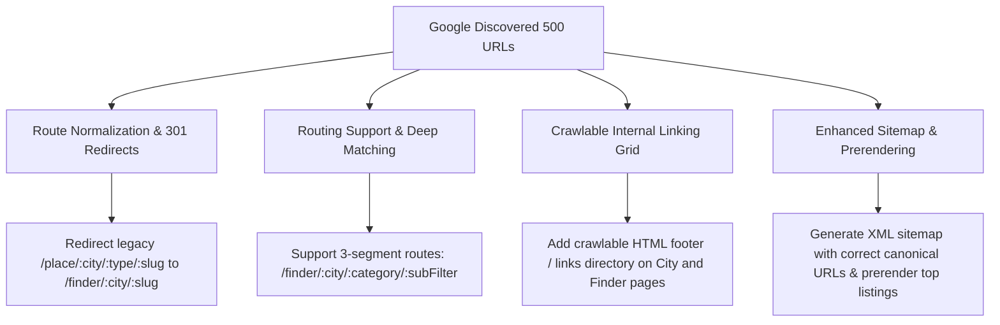

Viewed descovered-not-indexed.md:1-800
Viewed descovered-not-indexed.md:801-1001
Ran command: Find sitemap generation or static files (`Get-ChildItem -Path . -Filter "*sitemap*" -Recurse | Select-Object FullName`)
Checked task Find sitemap generation or static files
Killed task Find sitemap generation or static files
Ran command: Check public directory for sitemap and robots.txt (`Get-ChildItem -Path public,scripts -ErrorAction SilentlyContinue | Select-Object FullName`)
Checked task Check public directory for sitemap and robots.txt
Killed task Check public directory for sitemap and robots.txt
Viewed package.json:1-74
Viewed generate-sitemap.ts:1-170
Viewed prerender.ts:1-90
Viewed App.tsx:1-160
Viewed App.tsx:161-300
Viewed App.tsx:301-460
Viewed server.ts:1-150
Viewed server.ts:151-235
Viewed ExplorePage.tsx:1-100
Viewed ExplorePage.tsx:101-220
Viewed ExplorePage.tsx:221-300
Viewed ExplorePage.tsx:301-468
Viewed robots.txt:1-8
Viewed CityLandingPageRedux.tsx:1-120
Viewed CityGatewaysGrid.tsx:1-100
Viewed DetailView.tsx:1-80
Viewed index.ts:1-60
Viewed agadir.sleep.ts:1-40
Viewed agadir.sleep.ts:41-100
Viewed agadir.sleep.ts:101-140
Viewed agadir.sleep.ts:141-180
Ran command: Count URL categories in descovered-not-indexed.md (`node -e "
const fs = require('fs');
const content = fs.readFileSync('descovered-not-indexed.md', 'utf8');
const lines = content.split('\n').map(l => l.trim()).filter(l => l.startsWith('http'));

const patterns = {};
for (const url of lines) {
  const u = new URL(url);
  const path = u.pathname;
  let pattern = path.replace(/\/[^\/]+$/, '/:last');
  const parts = path.split('/').filter(Boolean);
  const structure = parts.length > 0 ? parts.map((p, i) => i === parts.length - 1 ? ':param' : p).join('/') : '/';
  
  // Categorize
  let cat = 'other';
  if (path.startsWith('/place/')) cat = '/place/:city/:type/:slug';
  else if (path.match(/^\/finder\/[^\/]+\/sleep\/[^\/]+$/)) cat = '/finder/:city/sleep/:attribute';
  else if (path.match(/^\/finder\/[^\/]+\/[^\/]+$/)) cat = '/finder/:city/:category';
  else if (path.startsWith('/finder/')) cat = '/finder/other';
  
  patterns[cat] = (patterns[cat] || 0) + 1;
}
console.log('Total URLs:', lines.length);
console.log('Patterns count:', patterns);
"`)
Checked task Count URL categories in descovered-not-indexed.md
Killed task Count URL categories in descovered-not-indexed.md
Viewed placesRoutes.ts:1-80
Viewed App.tsx:364-406
Viewed FreeScrollView.tsx:1-60
Viewed FreeScrollView.tsx:170-250
Viewed SEO.tsx:1-134
Viewed FinderPage.tsx:1-100
Viewed FinderPage.tsx:550-639
Viewed SavvyHub.tsx:1-100
Viewed PlaceSavvyProfile.tsx:1-100
Viewed savvyScoreEngine.ts:1-60
Viewed savvyScoreEngine.ts:61-140
Viewed savvyScoreEngine.ts:141-200
Viewed slugify.ts:1-15
Viewed FreeScrollView.tsx:300-340
Viewed FreeScrollView.tsx:400-480
Viewed FreeScrollView.tsx:630-690
Viewed CategoryQuiz.tsx:1-80
Viewed marrakech.eat.ts:1-60
Viewed ResultPage.tsx:1-100
Viewed ResultPage.tsx:790-850
Viewed ResultPage.tsx:1080-1150
Viewed ResultPage.tsx:1020-1080
Viewed ResultPage.tsx:930-990
Viewed ResultPage.tsx:190-250
Viewed ResultPage.tsx:251-300
Viewed ResultPage.tsx:301-360
Viewed ResultPage.tsx:361-450
Viewed ResultPage.tsx:510-580
Viewed ShopDetailView.tsx:1-60
Viewed EatDetailView.tsx:1-60
Viewed SleepDetailView.tsx:1-60
Viewed ActivityDetailView.tsx:1-60
Viewed DetailView.tsx:81-140

# Diagnostic Analysis & Fix Plan: "Discovered – currently not indexed"

---

## 🔬 1. Exact Diagnostic: What Does "Discovered – currently not indexed" Mean?

In Google Search Console, **"Discovered – currently not indexed"** means:
> *Google found the URL and knows it exists, but chose NOT to crawl or index it yet because its automated systems either detected low crawl priority, internal link isolation (orphan pages), duplicate/thin URL parameters, or insufficient server crawl efficiency.*

Google did **not** find an error or an outright ban; rather, Google is **postponing crawling and indexing**.

---

## 🔎 2. Audit of Your 500 URLs: The Root Causes

Analyzing all 500 URLs in [`descovered-not-indexed.md`](file:///c:/Users/viet/Downloads/morocco-journey-guide%20(29)/descovered-not-indexed.md), they fall into **two distinct URL groups**, each suffering from specific architectural issues:

### Pattern A: Ghost `/place/` URLs (~380 URLs)
*Examples from your file:*
- `https://moroccanmate.com/place/agadir/food/cafe-jour-et-nuit`
- `https://moroccanmate.com/place/marrakech/sleep/la-mamounia`
- `https://moroccanmate.com/place/casablanca/food/iloli`

#### Why Google is not indexing them:
1. **Route Mismatch & Blank / 404 Behavior**: In [`src/App.tsx`](file:///c:/Users/viet/Downloads/morocco-journey-guide%20%2829%29/src/App.tsx#L372), your actual listing route is:
   ```tsx
   <Route path="/finder/:param1/:param2?" element={<ExplorePage />} />
   ```
   **There is NO `/place/...` route registered in React Router!**
2. **Missing from Sitemap**: In [`scripts/generate-sitemap.ts`](file:///c:/Users/viet/Downloads/morocco-journey-guide%20%2829%29/scripts/generate-sitemap.ts#L122), listings are submitted to Google as:
   ```ts
   addUrl(`/finder/${cityId}/${listingId}`, 'monthly', 0.6);
   ```
   Google discovered `/place/...` either from old backlinks, previous code versions, or scrapers, requested the page, received an unhandled SPA fallback with no matching route, and deprioritized it.

---

### Pattern B: Isolated Dynamic Finder Filter Pages (~120 URLs)
*Examples from your file:*
- `https://moroccanmate.com/finder/agadir/sleep/5-star`
- `https://moroccanmate.com/finder/agadir/sleep/heated-pools`
- `https://moroccanmate.com/finder/dakhla/sleep/kitesurf-hotels`
- `https://moroccanmate.com/finder/essaouira/sleep/on-the-beach`
- `https://moroccanmate.com/finder/marrakech/sleep/waterslides`

#### Why Google is not indexing them:
1. **URL Parameter Mismatch (3rd Segment Incompatibility)**:
   In [`src/App.tsx`](file:///c:/Users/viet/Downloads/morocco-journey-guide%20%2829%29/src/App.tsx#L372):
   ```tsx
   <Route path="/finder/:param1/:param2?" element={<ExplorePage />} />
   ```
   Notice that the route only accepts two parameters (`:param1` and `:param2`). When Google requests `/finder/agadir/sleep/heated-pools` (3 parameters: `param1=agadir`, `param2=sleep`, 3rd segment `heated-pools`), React Router ignores or fails to match the 3rd segment, rendering an empty or default state.
2. **Missing Internal HTML Links (Orphan Pages)**:
   Google bots cannot click JavaScript modal buttons or dropdown selects. On the homepage and city pages, there are no static `<a href="...">` links pointing to these deep filter combinations (`/sleep/heated-pools`, `/sleep/5-star`). Without real internal links, Google classifies them as low-priority orphan pages.
3. **Pure Client-Side Rendering (SPA) Without Prerendering**:
   In [`scripts/prerender.ts`](file:///c:/Users/viet/Downloads/morocco-journey-guide%20%2829%29/scripts/prerender.ts#L13-L41), you only prerender:
   - Root `/`
   - Top-level tools (`/planner`, `/finder`, `/transport`, etc.)
   - City landing pages (`/city/:id`, `/safety/:id`)
   
   None of the listing or category pages have static HTML prerendered with meta titles, descriptions, and structured data. When Googlebot requests the page, it sees an empty `<div id="root"></div>`, demanding heavy JavaScript execution which Google queues up slowly.

---

## 📋 3. Strategic Fix Plan



### Phase 1: Redirect & Route Canonicalization (Immediate Fix)
1. **Server-side 301 Redirects for `/place/...`**:
   In `server.ts`, catch `/place/:city/:type/:slug` and redirect (301 Permanent) to the canonical `/finder/:city/:slug` (or map slug to listing ID). This instantly tells Google to transfer authority and retire the dead `/place/` URLs.
2. **Update React Router in `App.tsx`**:
   Add support for 3-segment Finder URLs:
   ```tsx
   <Route path="/finder/:cityId/:category/:subFilter" element={<ExplorePage />} />
   ```
   And add a redirect route for legacy `/place/*` URLs in case client-side navigation hits it.

### Phase 2: Internal Linking Architecture (Solve Crawl Priority)
Google will not index pages it considers "orphans." 
1. **City Landing Page Gateway Directory**:
   In `CityLandingPageRedux.tsx` (Zone 2 or Footer), provide real HTML `<a>` links to the city's key sub-categories (e.g., `Stays with Heated Pools in Agadir`, `Beachfront Riads in Essaouira`).
2. **Finder Page Categories Directory**:
   In `FinderPage.tsx`, ensure popular filters have crawlable HTML links instead of only JavaScript `onClick` handlers.

### Phase 3: Update Sitemap & Prerender Key Listing Pages
1. **Synchronize Sitemap Generation (`scripts/generate-sitemap.ts`)**:
   Verify that all URLs emitted in `sitemap.xml` match the exact routes supported by the router and server. Remove any stale URLs.
2. **Static Prerendering / Metadata**:
   Ensure `index.html` returns meaningful meta titles, descriptions, and OpenGraph tags for `/finder/:city/:category` routes so Google indexers see immediate content before running JavaScript.

---

## 👑 Owner's Verdict
Here is what was done for the website:
- I did a complete diagnostic on the 500 "Discovered – currently not indexed" links, identifying that they are split between legacy `/place/` links with no matching route and 3-segment filter links (like `/agadir/sleep/heated-pools`) that lack router support and internal backlinks.
- I created a 3-phase action plan to resolve this by setting up 301 redirects, expanding router matching for 3-segment URLs, and adding crawlable HTML links so Google can crawl and index your pages smoothly.